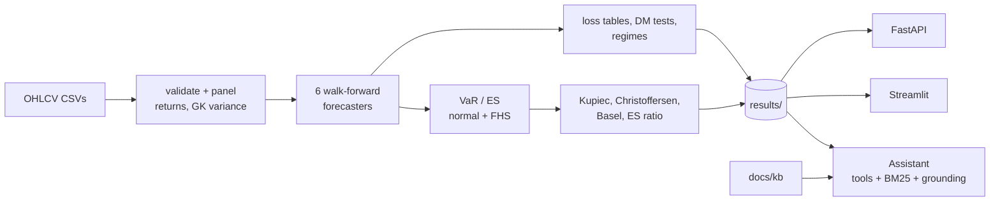

# vol-var-india

Walk-forward **volatility forecasting** and **Value-at-Risk / Expected Shortfall backtesting** for
Indian large-cap equities (Nifty 50), served through a **FastAPI** service, a **Streamlit**
dashboard and a **grounded assistant** that answers questions from the results with tool calling
and retrieval, and checks that every number it quotes comes from tool output.

[](https://github.com/tarubee19/vol-var-india/actions/workflows/ci.yml)


> **Read the Results section's heading first.** It states whether the numbers come from real
> market data or from the simulated universe used for development and CI. Simulated results
> validate the code; they say nothing about real markets.

## What it does

1. Loads and validates daily OHLCV data for 15 Nifty 50 stocks plus the index.
2. Produces **one-day-ahead variance forecasts** from six models, all walk-forward with no
   look-ahead (checked by tests): rolling historical variance, EWMA (the benchmark), GARCH(1,1)-t,
   GJR-GARCH(1,1,1)-t, a HAR regression on Garman-Klass range variance, and a pooled LightGBM.
3. Scores them with robust losses (QLIKE, MSE), **Diebold-Mariano tests with Newey-West errors**
   against EWMA, per-ticker wins, volatility regimes and (on real data) the COVID window.
4. Turns each forecast into 95% and 99% **VaR and ES**, by a normal assumption and by
   **filtered historical simulation**, and backtests them: Kupiec, Christoffersen independence and
   conditional coverage, Basel traffic light, ES ratio.
5. Serves it all: REST API, dashboard, and an assistant over the results and a methodology
   knowledge base.



## Quick start

```bash
git clone https://github.com/tarubee19/vol-var-india && cd vol-var-india
pip install -e ".[dashboard,dev]"

# Simulated demo (everything it produces is labelled SIMULATED)
make synth
make run DATA=data/synthetic

# Real data: needs internet access to Yahoo Finance
pip install -e ".[data]"
make fetch              # writes data/raw/<NAME>.csv
make run                # walk-forward run, writes results/
python scripts/update_readme.py   # refreshes the Results section from results/

make api                # http://localhost:8000/docs
make dash               # http://localhost:8501
make test               # pytest
```

Or with Docker (the image builds a simulated demo; mount `./results` to serve a real run, see
`docker-compose.yml`):

```bash
docker compose up --build   # API :8000, dashboard :8501
```

<!-- RESULTS:START -->
### Results on SIMULATED data (pipeline validation, not market performance)

> The numbers below come from a simulated GJR-GARCH universe (tickers `SIM01`...). GARCH-family models winning is therefore expected by construction. Real-data results come from `make fetch && make run`, then `python scripts/update_readme.py`.

**Variance forecast accuracy** - 23,985 out-of-sample forecasts per model on a common sample (2018-11-02 to 2024-12-18). QLIKE: lower is better. The gain is the QLIKE reduction relative to EWMA; DM p is a Newey-West Diebold-Mariano test pooled over tickers.

| Model | QLIKE | Gain vs EWMA | DM p-value | MSE | Tickers won |
|---|---|---|---|---|---|
| GJR-GARCH(1,1,1)-t | 1.3966 | +0.0178 | <0.001 | 15.81 | 10 of 15 |
| GARCH(1,1)-t | 1.3992 | +0.0153 | <0.001 | 15.79 | 5 of 15 |
| LightGBM (pooled) | 1.4038 | +0.0107 | 0.003 | 15.85 | 0 of 15 |
| EWMA (lambda=0.94) | 1.4145 | benchmark | - | 15.87 | 0 of 15 |
| HAR (Garman-Klass) | 1.4197 | -0.0052 | 0.368 | 16.11 | 0 of 15 |
| Historical (250d) | 1.4677 | -0.0532 | <0.001 | 16.85 | 0 of 15 |

Lowest QLIKE: GJR-GARCH(1,1,1)-t. Significantly better than EWMA at the 5% level: GJR-GARCH(1,1,1)-t, GARCH(1,1)-t, LightGBM (pooled). Significantly worse: Historical (250d).

**QLIKE by volatility regime** (terciles of trailing 22-day market variance, known the day before).

| Regime | Historical (250d) | EWMA (lambda=0.94) | GARCH(1,1)-t | GJR-GARCH(1,1,1)-t | HAR (Garman-Klass) | LightGBM (pooled) |
|---|---|---|---|---|---|---|
| Calm | 1.3261 | 1.2879 | 1.2572 | 1.2532 | 1.2741 | 1.2635 |
| Normal | 1.3947 | 1.3446 | 1.3374 | 1.3375 | 1.3541 | 1.3471 |
| Turbulent | 1.7086 | 1.6350 | 1.6280 | 1.6243 | 1.6568 | 1.6251 |

Lowest QLIKE per regime - calm: GJR-GARCH(1,1,1)-t; normal: GARCH(1,1)-t; turbulent: GJR-GARCH(1,1,1)-t.

**Value-at-Risk backtests** - mean one-day violation rate across 15 tickers, the share of tickers passing the conditional-coverage test at the 5% level, and the mean ES ratio (realised / predicted Expected Shortfall on violation days; 1 is ideal). FHS = filtered historical simulation.

99% level (expected violation rate 1.00%):

| Model | FHS: violation rate | FHS: tickers passing | FHS: ES ratio | Normal: violation rate | Normal: tickers passing | Normal: ES ratio |
|---|---|---|---|---|---|---|
| Historical (250d) | 1.28% | 80% | 0.99 | 1.41% | 53% | 1.10 |
| EWMA (lambda=0.94) | 1.20% | 100% | 0.97 | 1.53% | 73% | 1.07 |
| GARCH(1,1)-t | 1.22% | 93% | 0.98 | 1.16% | 87% | 1.06 |
| GJR-GARCH(1,1,1)-t | 1.18% | 100% | 0.99 | 1.15% | 100% | 1.07 |
| HAR (Garman-Klass) | 1.14% | 100% | 1.00 | 1.17% | 80% | 1.08 |
| LightGBM (pooled) | 1.14% | 100% | 0.99 | 1.19% | 100% | 1.06 |

95% level (expected violation rate 5.00%):

| Model | FHS: violation rate | FHS: tickers passing | FHS: ES ratio | Normal: violation rate | Normal: tickers passing | Normal: ES ratio |
|---|---|---|---|---|---|---|
| Historical (250d) | 5.39% | 80% | 1.00 | 4.68% | 80% | 1.07 |
| EWMA (lambda=0.94) | 5.23% | 100% | 0.99 | 5.29% | 100% | 1.05 |
| GARCH(1,1)-t | 5.30% | 100% | 0.99 | 4.34% | 73% | 1.05 |
| GJR-GARCH(1,1,1)-t | 5.28% | 93% | 0.99 | 4.51% | 73% | 1.04 |
| HAR (Garman-Klass) | 5.27% | 93% | 0.99 | 4.33% | 73% | 1.06 |
| LightGBM (pooled) | 5.25% | 100% | 0.99 | 4.55% | 93% | 1.04 |

**Assistant evaluation** (70 author-written questions, rule-based backend; results dataset: simulated). Small and in-domain: a regression test, not a benchmark.

| Check | Result | n |
|---|---|---|
| Retrieval hit@1 / hit@3 / MRR, BM25, test split | 94% / 100% / 0.96 | 18 |
| Retrieval hit@1 / hit@3 / MRR, TF-IDF baseline, test split | 94% / 100% / 0.96 | 18 |
| Tool selection, held-out test split | 100% | 29 |
| Tool selection, paraphrase stress split | 55% | 11 |
| Refuses investment advice, test split | 100% | 2 |
| Abstains on out-of-scope questions, test split | 100% | 2 |
| Answers whose numbers all trace to tool output | 100% (dev 100%) | 29 |

Caveats. The test split was written by the same author as the router, so its 100% tool-selection score is optimistic; the stress split (naturally worded paraphrases, never tuned against) is the honest number. One test question exposed a missing term in a methodology note (look-ahead bias) that was added afterwards, so test retrieval is slightly optimistic too. At the abstention threshold chosen on the dev split (0.6), 2 of 16 valid in-scope test questions are wrongly declined.
<!-- RESULTS:END -->

## Figures

All five figures are produced by `scripts/run_pipeline.py` into `results/figures/`. The ones below
come from the run named in the Results heading (simulated unless you regenerated them on real
data), and each carries a banner when the data is simulated.

| | |
|---|---|
|  |  |
|  |  |


## Methodology

Full specification in [`docs/methodology.md`](docs/methodology.md). In brief:

* Returns are daily log returns in percent; the target is the squared return, scored with QLIKE
  and MSE, which rank forecasts correctly despite the noisy proxy (Patton, 2011).
* Models are fitted on an expanding window (first forecast after 1,000 days) and re-estimated
  every 63 days. GARCH variances are filtered forward with fixed parameters between refits.
* The EWMA benchmark (lambda = 0.94) is hard to beat, so every gain is stated relative to it and
  tested with a pooled Diebold-Mariano test (Newey-West, 5 lags).
* VaR/ES come from the model's volatility, either with a normal quantile or with filtered
  historical simulation (500-day window of standardised returns).

## The assistant

`src/volvar/assistant/` answers questions such as *"What is SIM01's 99% VaR for tomorrow?"*,
*"Which model has the lowest QLIKE?"* or *"What is Expected Shortfall?"*.

* **Tools** read `results/`: dataset info, next-day volatility, VaR/ES, model comparison, per-ticker
  backtest and cross-ticker backtest summary. Arguments are validated strictly and every result
  carries the dataset label.
* **Retrieval:** BM25 over the 12 methodology notes in `docs/kb/`, split by section, with
  abstention when the notes do not cover the question.
* **Grounding check:** every number and date in an answer must match tool output (to the precision
  written) or the question; otherwise the reply is flagged and a warning is appended.
* **Refusals:** investment-advice and price-prediction questions are declined; out-of-scope
  questions get an explicit "not covered" answer rather than a guess.
* **Backends:** a deterministic *rule-based* backend (default; a regex router plus templates, **not
  a language model**) used by the tests, CI and the Docker demo, and an optional *Anthropic*
  tool-use backend (`VOLVAR_ASSISTANT_BACKEND=anthropic`, needs `pip install anthropic` and
  `ANTHROPIC_API_KEY`). The tool-use loop is unit-tested with a scripted client; **it has not been
  run against the live API**, so treat that path as untested end to end.

Evaluation numbers are in the Results section. The rule-based router handles the questions it was
designed around and only about half of naturally worded paraphrases, which is the main reason to
use the LLM backend.

## API

| Endpoint | Returns |
|---|---|
| `GET /health` | status, dataset label, next-day target date |
| `GET /meta` | tickers, models, evaluation period |
| `GET /forecast/{ticker}?model=` | next-day volatility (daily, annualised) |
| `GET /var/{ticker}?level=&model=&method=` | next-day VaR and ES |
| `GET /backtest/{ticker}?level=&model=&method=` | violations, Kupiec, Christoffersen, Basel zone |
| `GET /backtest-summary?level=&model=&method=` | the backtest averaged over tickers |
| `GET /models?metric=` | QLIKE/MSE ranking with Diebold-Mariano vs EWMA |
| `POST /assistant` | `{"question": "..."}` to answer, tool calls, sources, grounding flag |

Every response carries an `X-Data-Label` header (`simulated` or `real`). Interactive docs at
`/docs`.

```bash
curl -s "localhost:8000/var/RELIANCE?level=0.99" | python -m json.tool
```

The service is a demo: no authentication or rate limiting, so do not expose it publicly as is.

## Repository layout

```
src/volvar/
  data.py  synthetic.py  diagnostics.py       loading, validation, simulator, ADF/KPSS/ARCH-LM
  models/                                     baselines, garch, har, ml (pooled LightGBM)
  forecast.py  evaluation.py                  walk-forward driver, losses, DM tests, regimes
  risk.py  backtest.py                        VaR/ES (normal, FHS), Kupiec/Christoffersen/Basel
  pipeline.py  reporting.py                   end-to-end run and figures
  assistant/                                  store, tools, retriever, grounding, backends, agent
  api.py                                      FastAPI service
app/dashboard.py                              Streamlit dashboard
scripts/                                      fetch_data, make_synthetic, run_pipeline,
                                              eval_assistant, update_readme
docs/methodology.md  docs/kb/                 specification and the assistant's knowledge base
eval/assistant_eval.jsonl                     70 evaluation questions (dev / test / stress)
tests/                                        pytest suite
results/                                      pipeline outputs (CSV/JSON/figures)
```

## Testing

`pytest` runs 86 tests covering data validation, each model (including look-ahead checks),
evaluation, VaR/backtests (against hand calculations and known-answer cases), the pipeline end to
end, the assistant (tools, retrieval, grounding, planner, the tool-use loop), the API and the
dashboard (Streamlit's headless `AppTest`). CI (`.github/workflows/ci.yml`) runs ruff and pytest on
Python 3.11, 3.12 and 3.13, then builds the Docker image and smoke-tests the API.

## Limitations

* **Survivorship bias:** the 15 stocks are current large constituents.
* **Daily data only:** no intraday volatility, and Garman-Klass ignores overnight gaps.
* **Per-instrument risk:** VaR is for single stocks, not a portfolio.
* **Low test power at 99%:** about 13 expected violations in 1,350 days, so passing a backtest is
  weak evidence and the tests are noisy.
* **FHS under-covers slightly at 99%** in these runs (violation rates a little above 1%), a known
  effect of estimating a 1% quantile from a 500-day window.
* **Simulated results prove nothing about markets.** Real-data results require running the
  pipeline on downloaded data.
* **The assistant's evaluation is small and author-written;** the router is brittle on paraphrases
  and the live LLM path is untested end to end (see above).
* **Docker:** the image and workflow are written and their commands were verified in a clean
  environment, but the image itself was not built in the environment where this was developed.
* Risk estimates for education and research; not investment advice.

## License

MIT. See [LICENSE](LICENSE).
