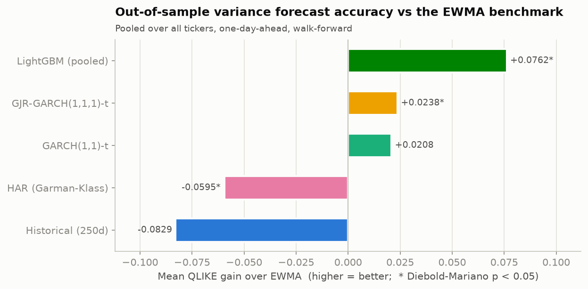
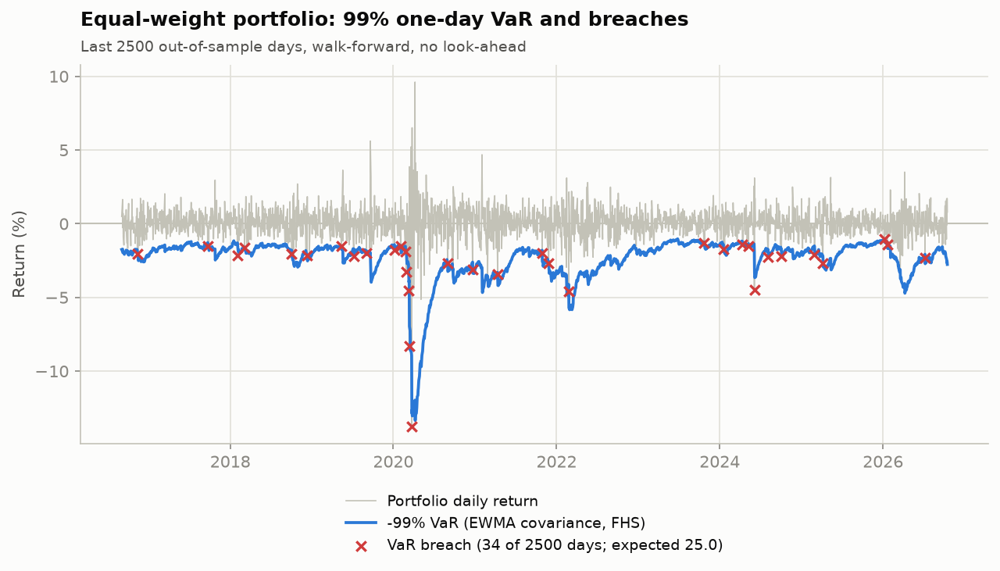
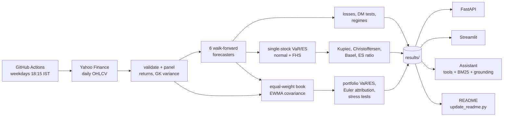
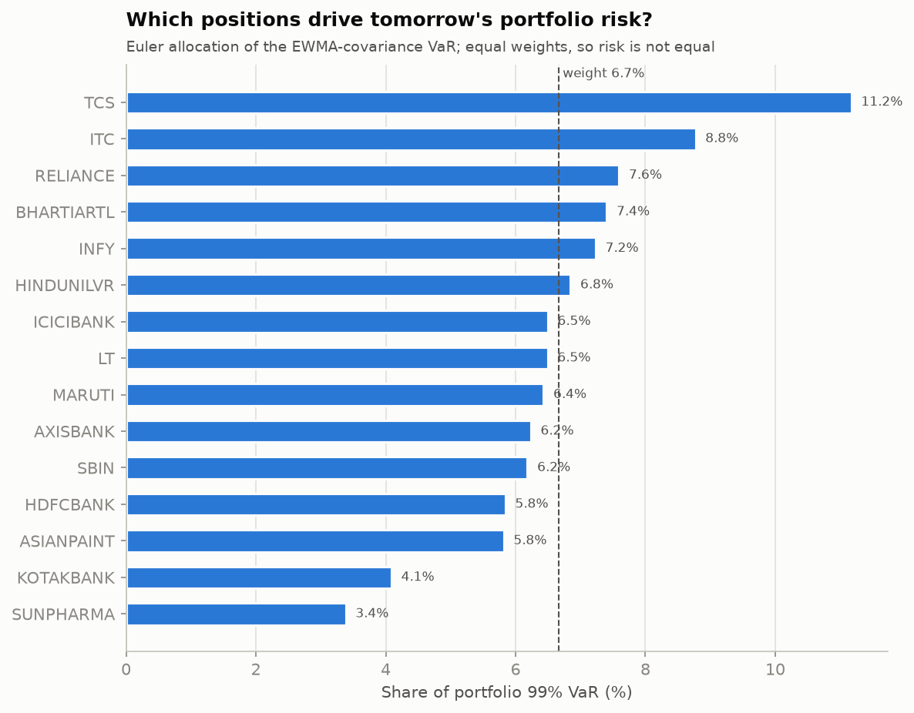
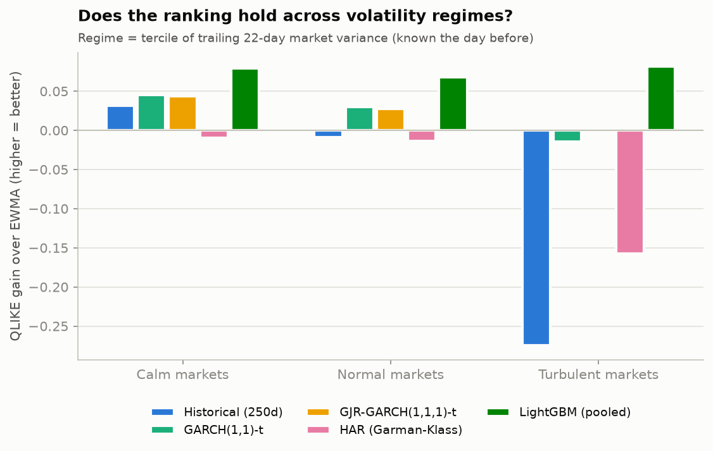
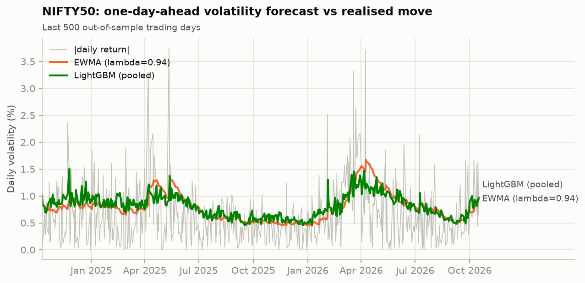
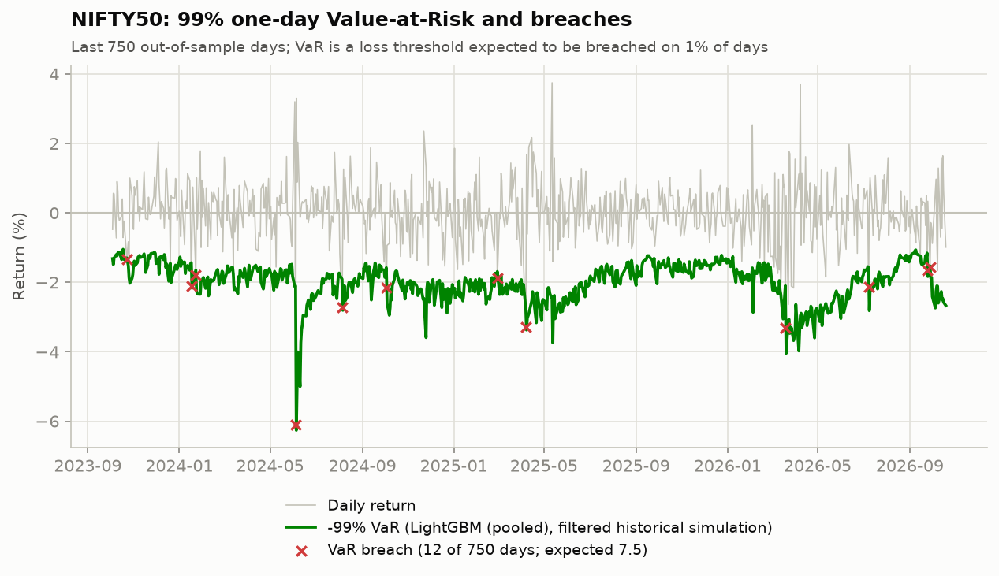
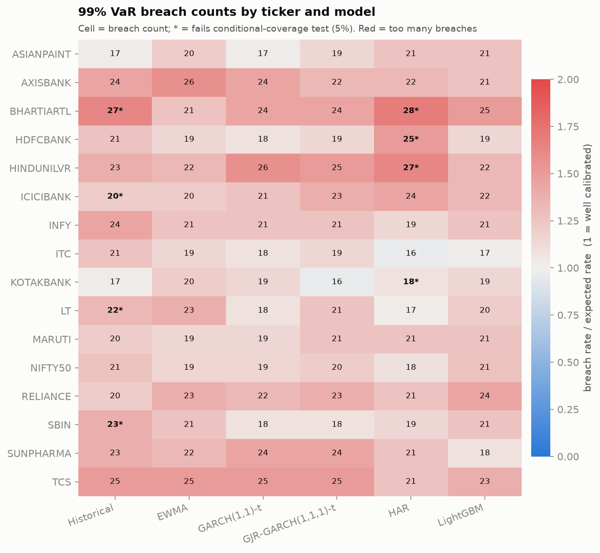

# vol-var-india: a market-risk engine for Nifty 50 equities

Walk-forward **volatility forecasting**, **Value-at-Risk / Expected Shortfall** backtesting and
**portfolio risk** (attribution and stress tests) for 15 large Nifty 50 stocks and the index, on
real daily prices from 2015 onward. The whole study is **re-run from fresh market data every
weekday** by GitHub Actions, and served through a FastAPI service, a Streamlit dashboard and a
grounded Q&A assistant.

[](https://github.com/tarubee19/vol-var-india/actions/workflows/ci.yml)
[](https://github.com/tarubee19/vol-var-india/actions/workflows/refresh.yml)


## Headline results

Every number below is written by `scripts/update_readme.py` from the files in `results/`, never
typed by hand, and refreshed with the data.

<!-- HEADLINE:START -->
- **Forecasting:** on 30,679 out-of-sample forecasts (2019-01-22 to 2026-10-28), LightGBM (pooled) cuts QLIKE loss by 4.1% against the RiskMetrics EWMA benchmark (Diebold-Mariano p <0.001) and has the lowest loss on 16 of 16 series.
- **Single-stock VaR:** 99% filtered-historical-simulation VaR on the EWMA forecast passes Christoffersen's conditional-coverage test on 100% of series (mean ES ratio 1.00).
- **Portfolio VaR:** the equal-weight book's 99% VaR (EWMA covariance + FHS) is breached on 1.44% of 1,668 days (target 1%), Kupiec p 0.09, Basel zone green.
- **Stress:** replayed on today's book, the worst historical scenario is the COVID-19 crash (-34.6%, INR -34.59 lakh on INR 1 crore).
<!-- HEADLINE:END -->

| | |
|---|---|
|  |  |

## Today's risk snapshot

<!-- SNAPSHOT:START -->
Forecasts for **2026-10-29**, using closing prices up to 2026-10-28. Rebuilt every weekday after the NSE close by the [daily refresh workflow](https://github.com/tarubee19/vol-var-india/actions/workflows/refresh.yml).

| Equal-weight book (INR 1 crore) | VaR | Expected Shortfall |
|---|---|---|
| 95.0% level | 1.39% (INR 1.39 lakh) | 1.81% (INR 1.81 lakh) |
| 97.5% level | 1.57% (INR 1.57 lakh) | 2.12% (INR 2.12 lakh) |
| 99.0% level | 2.35% (INR 2.35 lakh) | 2.58% (INR 2.58 lakh) |

<details><summary>Per-stock next-day risk (LightGBM (pooled), filtered historical simulation)</summary>

| Ticker | Daily vol | Annualised vol | 99% VaR | 99% ES |
|---|---|---|---|---|
| INFY | 2.41% | 38.2% | 7.49% | 8.87% |
| HINDUNILVR | 2.12% | 33.6% | 5.61% | 9.01% |
| TCS | 1.85% | 29.4% | 5.20% | 6.63% |
| LT | 1.71% | 27.2% | 4.99% | 5.70% |
| RELIANCE | 1.89% | 29.9% | 4.63% | 5.90% |
| BHARTIARTL | 1.58% | 25.1% | 4.43% | 5.14% |
| MARUTI | 1.64% | 26.0% | 4.37% | 5.35% |
| ASIANPAINT | 1.48% | 23.5% | 3.72% | 5.12% |
| AXISBANK | 1.17% | 18.5% | 3.47% | 4.81% |
| HDFCBANK | 1.40% | 22.2% | 3.47% | 4.58% |
| ITC | 1.59% | 25.3% | 3.11% | 8.53% |
| KOTAKBANK | 1.21% | 19.2% | 3.03% | 4.40% |
| SUNPHARMA | 1.16% | 18.5% | 2.84% | 3.48% |
| ICICIBANK | 1.18% | 18.8% | 2.83% | 3.32% |
| SBIN | 1.28% | 20.3% | 2.78% | 3.91% |
| NIFTY50 | 0.91% | 14.5% | 2.41% | 2.81% |

</details>
<!-- SNAPSHOT:END -->

## What it does

1. **Data:** downloads and validates daily OHLCV for 15 Nifty 50 stocks and the index (Yahoo
   Finance, split and dividend adjusted).
2. **Forecasts:** one-day-ahead variance forecasts from six models, all walk-forward with no
   look-ahead (enforced by tests): rolling historical variance, EWMA (the RiskMetrics benchmark),
   GARCH(1,1)-t, GJR-GARCH(1,1,1)-t, a HAR regression on Garman-Klass range variance, and a pooled
   LightGBM.
3. **Evaluation:** robust losses (QLIKE, MSE), **Diebold-Mariano tests with Newey-West errors**
   against EWMA, per-ticker wins, volatility regimes and the COVID-2020 window.
4. **Single-stock VaR/ES** at 95% and 99%, by a normal assumption and by **filtered historical
   simulation**, backtested with Kupiec, Christoffersen (independence and conditional coverage),
   the Basel traffic light and the ES ratio.
5. **Portfolio risk** for an equal-weight INR 1 crore book: four portfolio VaR/ES models
   (historical simulation, EWMA covariance with normal and FHS tails, and a bottom-up model that
   combines each stock's LightGBM forecast with the EWMA correlation matrix), backtested at 95%,
   97.5% (the Basel FRTB ES level) and 99%; **Euler risk attribution** by position; **stress
   tests** that replay past Indian market shocks on today's book plus beta-mapped and sector shocks.
6. **Serving:** REST API, dashboard, and an assistant that answers from the results and a
   methodology knowledge base and checks every number it quotes against tool output.
7. **Automation:** a scheduled workflow fetches the day's prices after the NSE close, re-runs
   everything and commits the refreshed results and README.



## Quick start

```bash
git clone https://github.com/tarubee19/vol-var-india && cd vol-var-india
pip install -e ".[dashboard,data,dev]"

make fetch              # download prices into data/raw/ (needs internet access to Yahoo Finance)
make run                # full walk-forward study, writes results/ (about 3 minutes)
python scripts/update_readme.py   # rewrite the README numbers from results/

make api                # http://localhost:8000/docs
make dash               # http://localhost:8501
make test               # pytest
```

The committed `results/` already hold the latest real-data run, so `make api` and `make dash`
work straight after cloning. With Docker:

```bash
docker compose up --build   # API :8000, dashboard :8501, serving the committed results
```

## Results

<!-- RESULTS:START -->
### Results on real Nifty 50 data

> 16 series, 2019-01-22 to 2026-10-28 out of sample.

**Variance forecast accuracy** - 30,679 out-of-sample forecasts per model on a common sample (2019-01-22 to 2026-10-28). QLIKE: lower is better. The gain is the QLIKE reduction relative to EWMA; DM p is a Newey-West Diebold-Mariano test pooled over tickers.

| Model | QLIKE | Gain vs EWMA | DM p-value | MSE | Tickers won |
|---|---|---|---|---|---|
| LightGBM (pooled) | 1.7681 | +0.0759 | <0.001 | 115.77 | 16 of 16 |
| GJR-GARCH(1,1,1)-t | 1.8204 | +0.0237 | 0.040 | 119.46 | 0 of 16 |
| GARCH(1,1)-t | 1.8234 | +0.0207 | 0.107 | 120.98 | 0 of 16 |
| EWMA (lambda=0.94) | 1.8441 | benchmark | - | 120.92 | 0 of 16 |
| HAR (Garman-Klass) | 1.9035 | -0.0594 | 0.025 | 118.41 | 0 of 16 |
| Historical (250d) | 1.9266 | -0.0825 | 0.073 | 128.56 | 0 of 16 |

Lowest QLIKE: LightGBM (pooled). Significantly better than EWMA at the 5% level: LightGBM (pooled), GJR-GARCH(1,1,1)-t. Significantly worse: HAR (Garman-Klass).

**QLIKE by volatility regime** (terciles of trailing 22-day market variance, known the day before).

| Regime | Historical (250d) | EWMA (lambda=0.94) | GARCH(1,1)-t | GJR-GARCH(1,1,1)-t | HAR (Garman-Klass) | LightGBM (pooled) |
|---|---|---|---|---|---|---|
| Calm | 1.4349 | 1.4664 | 1.4210 | 1.4231 | 1.4757 | 1.3892 |
| Normal | 1.7875 | 1.7796 | 1.7488 | 1.7512 | 1.7927 | 1.7121 |
| Turbulent | 2.5787 | 2.3045 | 2.3196 | 2.3062 | 2.4612 | 2.2218 |

Lowest QLIKE per regime - calm: LightGBM (pooled); normal: LightGBM (pooled); turbulent: LightGBM (pooled).

**COVID window (Feb-Jun 2020)**

| model | qlike | mse | n |
|---|---|---|---|
| hist | 5.1571 | 2008.5546 | 1424 |
| ewma | 3.7617 | 1878.5719 | 1424 |
| garch | 3.9504 | 1887.786 | 1424 |
| gjr | 3.8545 | 1851.6439 | 1424 |
| har | 4.37 | 1828.2346 | 1424 |
| lgbm | 3.519 | 1784.4566 | 1424 |
**Value-at-Risk backtests** - mean one-day violation rate across 16 tickers, the share of tickers passing the conditional-coverage test at the 5% level, and the mean ES ratio (realised / predicted Expected Shortfall on violation days; 1 is ideal). FHS = filtered historical simulation.

99% level (expected violation rate 1.00%):

| Model | FHS: violation rate | FHS: tickers passing | FHS: ES ratio | Normal: violation rate | Normal: tickers passing | Normal: ES ratio |
|---|---|---|---|---|---|---|
| Historical (250d) | 1.30% | 81% | 1.04 | 1.74% | 19% | 1.34 |
| EWMA (lambda=0.94) | 1.27% | 100% | 1.00 | 1.83% | 12% | 1.25 |
| GARCH(1,1)-t | 1.26% | 100% | 1.00 | 1.56% | 38% | 1.24 |
| GJR-GARCH(1,1,1)-t | 1.28% | 100% | 1.00 | 1.53% | 50% | 1.23 |
| HAR (Garman-Klass) | 1.27% | 75% | 1.02 | 1.84% | 56% | 1.24 |
| LightGBM (pooled) | 1.27% | 100% | 1.00 | 1.59% | 50% | 1.20 |

95% level (expected violation rate 5.00%):

| Model | FHS: violation rate | FHS: tickers passing | FHS: ES ratio | Normal: violation rate | Normal: tickers passing | Normal: ES ratio |
|---|---|---|---|---|---|---|
| Historical (250d) | 5.45% | 56% | 1.01 | 4.16% | 31% | 1.27 |
| EWMA (lambda=0.94) | 5.33% | 94% | 1.01 | 4.89% | 88% | 1.19 |
| GARCH(1,1)-t | 5.20% | 81% | 1.01 | 3.98% | 38% | 1.20 |
| GJR-GARCH(1,1,1)-t | 5.16% | 94% | 1.00 | 3.93% | 38% | 1.19 |
| HAR (Garman-Klass) | 5.43% | 88% | 0.99 | 4.56% | 31% | 1.20 |
| LightGBM (pooled) | 5.27% | 88% | 1.00 | 4.44% | 81% | 1.15 |

**Portfolio VaR backtests** - a daily-rebalanced equal-weight book of 15 stocks, 1,668 common out-of-sample days (2020-01-31 to 2026-10-28). The 99% VaR should be breached on 1% of days; ES ratio = realised / predicted shortfall on breach days (1 is ideal); 97.5% is the Basel FRTB Expected Shortfall level.

| Model | 99% breaches | Kupiec p | Cond. coverage p | Basel zone (last 250d) | ES ratio 99% | ES ratio 97.5% | Passes |
|---|---|---|---|---|---|---|---|
| Historical simulation (500d) | 22 of 1668 (1.32%) | 0.212 | 0.342 | yellow | 1.05 | 1.02 | yes |
| EWMA covariance, normal | 33 of 1668 (1.98%) | 0.000 | 0.001 | yellow | 1.25 | 1.28 | no |
| EWMA covariance, FHS | 24 of 1668 (1.44%) | 0.091 | 0.169 | green | 1.03 | 1.08 | yes |
| LightGBM vols + EWMA correlation, FHS | 22 of 1668 (1.32%) | 0.212 | 0.342 | green | 1.03 | 1.06 | yes |

**Risk attribution** (Euler allocation of tomorrow's 99% VaR). Each stock is 6.7% of the book, but the top three risk contributors are TCS 10.4%, ITC 8.8%, INFY 8.5%. Diversification cuts the VaR by 45% against the sum of stand-alone position VaRs.

**Stress tests on today's book** - historical crises replayed on the equal-weight portfolio, and instantaneous hypothetical shocks (the Nifty shock is mapped through each stock's 250-day beta).

| Scenario | Window | Book P&L | On INR 1 crore | Nifty 50 | 99% VaR breaches |
|---|---|---|---|---|---|
| Brexit referendum result | 2016-06-24 to 2016-06-24 | -2.18% | INR -2.18 lakh | -2.20% | 0 |
| Demonetisation announcement | 2016-11-09 to 2016-11-21 | -5.45% | INR -5.45 lakh | -7.19% | 1 |
| IL&FS / NBFC credit scare | 2018-08-29 to 2018-10-26 | -13.94% | INR -13.94 lakh | -14.55% | 1 |
| COVID-19 crash | 2020-02-20 to 2020-03-23 | -34.59% | INR -34.59 lakh | -37.24% | 5 |
| Russia invades Ukraine | 2022-02-24 to 2022-02-24 | -4.59% | INR -4.59 lakh | -4.78% | 1 |
| 2024 general election results day | 2024-06-04 to 2024-06-04 | -4.49% | INR -4.49 lakh | -5.93% | 1 |
| Global sell-off (yen carry unwind) | 2024-08-05 to 2024-08-05 | -2.25% | INR -2.25 lakh | -2.68% | 1 |
| Nifty 50 falls 10% (beta-mapped) | instantaneous | -9.35% | INR -9.35 lakh | - | - |
| Banks fall 15% | instantaneous | -5.00% | INR -5.00 lakh | - | - |
| IT services fall 12% | instantaneous | -1.60% | INR -1.60 lakh | - | - |

**Assistant evaluation** (70 author-written questions, rule-based backend; results dataset: real). Small and in-domain: a regression test, not a benchmark.

| Check | Result | n |
|---|---|---|
| Retrieval hit@1 / hit@3 / MRR, BM25, test split | 94% / 100% / 0.96 | 18 |
| Retrieval hit@1 / hit@3 / MRR, TF-IDF baseline, test split | 94% / 100% / 0.96 | 18 |
| Tool selection, held-out test split | 100% | 29 |
| Tool selection, paraphrase stress split | 55% | 11 |
| Refuses investment advice, test split | 100% | 2 |
| Abstains on out-of-scope questions, test split | 100% | 2 |
| Answers whose numbers all trace to tool output | 100% (dev 100%) | 29 |

Caveats. The test split was written by the same author as the router, so its 100% tool-selection score is optimistic; the stress split (naturally worded paraphrases, never tuned against) is the honest number. One test question exposed a missing term in a methodology note (look-ahead bias) that was added afterwards, so test retrieval is slightly optimistic too. At the abstention threshold chosen on the dev split (0.6), 2 of 16 valid in-scope test questions are wrongly declined.
<!-- RESULTS:END -->

## Figures

Rendered by `scripts/run_pipeline.py` into `results/figures/` from the real-data run.

| | |
|---|---|
|  |  |
|  |  |



## Methodology

Full specification in [`docs/methodology.md`](docs/methodology.md). In brief:

* Returns are daily log returns in percent; the target is the squared return, scored with QLIKE
  and MSE, which rank forecasts correctly despite the noisy proxy (Patton, 2011).
* Models are fitted on an expanding window (first forecast after 1,000 days) and re-estimated
  every 63 days. GARCH variances are filtered forward with fixed parameters between refits.
* The EWMA benchmark (lambda = 0.94) is hard to beat, so every gain is stated relative to it and
  tested with a pooled Diebold-Mariano test (Newey-West, 5 lags).
* VaR/ES come from the model's volatility, either with a normal quantile or with filtered
  historical simulation (500-day window of standardised returns).
* The portfolio is a daily-rebalanced equal-weight book of the 15 stocks. Its covariance is
  RiskMetrics EWMA; the bottom-up model rescales the EWMA correlation matrix with each stock's
  LightGBM volatility forecast. Euler allocation splits tomorrow's VaR into position components that
  add up exactly. Stress scenarios are dated historical windows replayed on today's weights plus
  instantaneous shocks (Nifty 50 -10% through 250-day betas, banks -15%, IT services -12%).

## The assistant

`src/volvar/assistant/` answers questions such as *"What is RELIANCE's 99% VaR for tomorrow?"*,
*"Which model has the lowest QLIKE?"* or *"What is Expected Shortfall?"*. Tools read `results/`
(arguments validated, every result carries the dataset label); BM25 retrieval over the 12
methodology notes in `docs/kb/` handles definitions and abstains when they do not cover the
question; a **grounding check** flags any number or date in an answer that does not match tool
output; investment-advice and price-prediction questions are refused.

The default backend is deterministic and rule-based (a router plus templates, not a language
model), which keeps CI and the Docker demo reproducible. An Anthropic tool-use backend
(`VOLVAR_ASSISTANT_BACKEND=anthropic`, needs `ANTHROPIC_API_KEY`) is unit-tested with a scripted
client but has not been evaluated against the live API. Evaluation numbers are in the results
section; the honest figure is tool selection on naturally worded paraphrases.

## API

| Endpoint | Returns |
|---|---|
| `GET /health` | status, dataset label, next-day target date |
| `GET /meta` | tickers, models, evaluation period |
| `GET /forecast/{ticker}?model=` | next-day volatility (daily, annualised) |
| `GET /var/{ticker}?level=&model=&method=` | next-day VaR and ES |
| `GET /backtest/{ticker}?level=&model=&method=` | violations, Kupiec, Christoffersen, Basel zone |
| `GET /backtest-summary?level=&model=&method=` | the backtest averaged over tickers |
| `GET /models?metric=` | QLIKE/MSE ranking with Diebold-Mariano vs EWMA |
| `GET /portfolio` | book VaR/ES (percent and INR), backtests, risk contributions, stress tests |
| `POST /assistant` | `{"question": "..."}` to answer, tool calls, sources, grounding flag |

Every response carries an `X-Data-Label` header. Interactive docs at `/docs`.

```bash
curl -s "localhost:8000/var/RELIANCE?level=0.99" | python -m json.tool
curl -s localhost:8000/portfolio | python -m json.tool
```

The service has no authentication or rate limiting, so do not expose it publicly as is.

## Daily refresh

[`.github/workflows/refresh.yml`](.github/workflows/refresh.yml) runs at 12:45 UTC (18:15 IST) on
weekdays and can be started by hand from the Actions tab. It downloads prices, re-runs the full
walk-forward study, re-scores the assistant, rewrites the README blocks and commits the changed
files in `results/` (figures on Fridays and manual runs). Each refresh is one commit, so the
history doubles as an audit trail of the daily risk numbers.

## Development and testing on simulated data

`make synth && make run DATA=data/synthetic` builds a simulated universe (tickers `SIM01`...,
market factor plus GJR-GARCH components with Student-t shocks) and runs the same pipeline on it.
Everything it produces is labelled SIMULATED in files, figures, the API header and the dashboard,
so it cannot be confused with market results. It exists to test the code: because the true process
is known, it checks that the GARCH-family models recover what they are built for.

`pytest` runs 98 tests: data validation, each model (including look-ahead checks), evaluation,
VaR/backtests against hand calculations, the data download (partial intraday bars are dropped), the portfolio module (covariance recursion and
no-look-ahead, Euler components adding up, historical-simulation quantiles, stress P&L), the
pipeline end to end, the assistant, the API and the dashboard (Streamlit's headless `AppTest`).
CI runs ruff and pytest on Python 3.11, 3.12 and 3.13, then builds the Docker image and
smoke-tests the API.

## Repository layout

```
src/volvar/
  data.py  synthetic.py  diagnostics.py       loading, validation, simulator, ADF/KPSS/ARCH-LM
  models/                                     baselines, garch, har, ml (pooled LightGBM)
  forecast.py  evaluation.py                  walk-forward driver, losses, DM tests, regimes
  risk.py  backtest.py                        VaR/ES (normal, FHS), Kupiec/Christoffersen/Basel
  portfolio.py                                portfolio VaR/ES, Euler attribution, stress tests
  pipeline.py  reporting.py                   end-to-end run and figures
  assistant/                                  store, tools, retriever, grounding, backends, agent
  api.py                                      FastAPI service
app/dashboard.py                              Streamlit dashboard
scripts/                                      fetch_data, make_synthetic, run_pipeline,
                                              eval_assistant, update_readme
.github/workflows/                            ci.yml, refresh.yml (daily real-data run)
docs/methodology.md  docs/kb/                 specification and the assistant's knowledge base
eval/assistant_eval.jsonl                     70 evaluation questions (dev / test / stress)
tests/                                        pytest suite
results/                                      latest real-data outputs (CSV/JSON/figures)
```

## Limitations

* **Survivorship bias:** the 15 stocks are today's large constituents.
* **Daily data only:** no intraday volatility, and Garman-Klass ignores overnight gaps.
* **The book is illustrative:** equal weights, no transaction costs, one-day horizon, no liquidity
  horizon or FX; the bottom-up model reuses the EWMA correlation rather than a fitted DCC.
* **Low test power at 99%:** roughly 15-20 expected violations per series over the test window, so
  a pass is weak evidence and a clear failure is strong evidence.
* **One market:** the 16 series share one market, so "best on all series" is not 16 independent
  confirmations, and no multiple-comparison correction is applied across the six models.
* **The assistant's evaluation is small and author-written**, and the rule-based router handles
  only about half of naturally worded paraphrases.
* Risk estimates for education and research; not investment advice.

## License

MIT. See [LICENSE](LICENSE).
